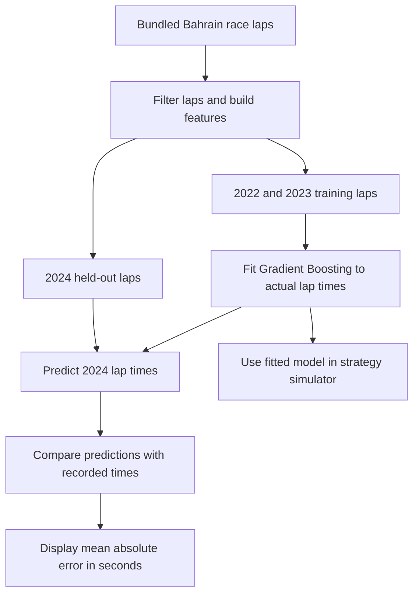
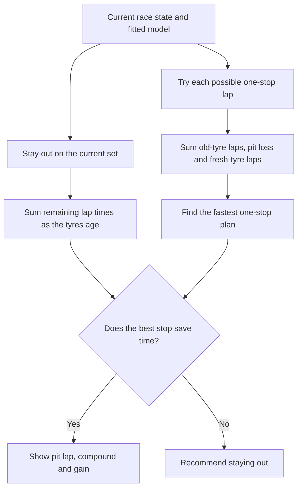

# F1 Pit Stop Predictor

A Streamlit app for exploring one decision at the Bahrain Grand Prix: **will a fresh set of tyres save enough time over the remaining laps to pay for a pit stop?** Enter the lap just completed, the age and compound of the current tyres, the replacement compound and an assumed pit-stop loss. The app compares staying out with a single stop on every eligible lap and recommends the plan with the shortest predicted time to the finish.

## Run locally

Extract the project and open PowerShell in the folder containing `app.py`. Run these commands in order. The explicit Streamlit version and project-local Python interpreter keep the setup isolated from other Python projects.

```powershell
python -m venv .venv
.\.venv\Scripts\python.exe -m pip install "streamlit==1.45.1" -r requirements.txt
.\.venv\Scripts\python.exe -m pip check
.\.venv\Scripts\python.exe -m streamlit run app.py
```

Open the **Local URL** printed in the terminal. The three Bahrain race sessions are included in data/bahrain_laps.csv. Only installing the Python packages requires internet. Keep the terminal open while using the app. For future launches, run the last command from the project folder.

## How the model learns lap time



Each training row represents one completed lap. The cleaner keeps laps marked accurate, with green track status, a dry compound, a tyre age of at least one lap and a positive recorded time. It excludes opening laps and laps on which a driver entered or exited the pits. The simulator accounts for pit loss separately.

| Model input | Meaning |
| --- | --- |
| Tyre age | Laps run on the current set, including the lap being predicted |
| Race progress | Lap number divided by the race distance in laps |
| Tyre compound | Three indicator columns for soft, medium and hard |

The target is **lap time in seconds**. In `core.py`, `train()` fits a scikit-learn `GradientBoostingRegressor` to the 2022–2023 laps. It evaluates the fitted model on 2024 and displays the actual sample counts and mean absolute error (MAE). An MAE of 1 second, for example, means predictions differ from recorded lap times by 1 second on average in absolute terms. This metric evaluates lap-time accuracy. Strategy recommendations are evaluated through simulation.

## How the app chooses a pit lap



A stop takes place **at the end of the selected lap**. If lap 25 is the lap just completed, choosing lap 25 means pitting immediately and starting lap 26 on fresh tyres. The simulator tries every stop from lap 25 through the penultimate lap. Staying out wins a tie.

```text
Stay-out time = sum of predicted remaining laps on the current set
One-stop time = time before the stop + pit loss + time on the new set
Gain          = stay-out time − one-stop time
```

## Try a scenario

Use the default inputs: **lap 25 completed**, **12-lap-old mediums**, **fresh hards** and **22 seconds of pit loss**. On the chart, the horizontal axis is the lap at whose end you would stop. The vertical axis is the predicted remaining race time. Staying out gives a horizontal line because that plan is the same at every candidate pit lap.

Now raise pit loss from **22 to 27 seconds**. Every one-stop plan becomes exactly five seconds slower, while the stay-out line stays fixed. The best lap *among one-stop plans* stays the same. The overall recommendation can switch to staying out if those five seconds erase the advantage of pitting.

## Project files

| File | Responsibility |
| --- | --- |
| `app.py` | Reads the bundled CSV, prepares the model, accepts scenario inputs and displays the decision and chart |
| `core.py` | Builds features, filters laps, trains and evaluates the model, and compares pit strategies |
| `requirements.txt` | Declares Streamlit, scikit-learn, pandas and NumPy dependencies |

Streamlit keeps the fitted model in memory while the server runs. Changing inputs or refreshing the page reuses that model. Restarting the server trains it again, from the bundled CSV.

## Scope and assumptions

The app simulates dry, green-flag running at Bahrain using the race distance from the 2024 session. It assumes one fresh replacement set, a fixed time loss for any stop, and that both candidate plans are legal for the driver. The model pools laps across drivers and teams. Traffic, safety cars, weather changes and individual car pace can all affect the outcome of a real race. A small predicted gain is therefore best read as a close comparison under the selected assumptions.

## Data and project background

- Bundled CSV: selected lap timing fields from the TracingInsights Bahrain Race session archives ([2022](https://github.com/TracingInsights/2022/tree/main/Bahrain%20Grand%20Prix/Race), [2023](https://github.com/TracingInsights/2023/tree/main/Bahrain%20Grand%20Prix/Race), [2024](https://github.com/TracingInsights/2024/tree/main/Bahrain%20Grand%20Prix/Race)). Each season comes from session_laptimes.json. Lap and pit times are in seconds.
- Project inspiration: [F1-Research by Priyanshu Nayak and Vidita Nayak](https://github.com/Price1232/F1-Research). This mini project focuses on the Bahrain one-stop decision.
